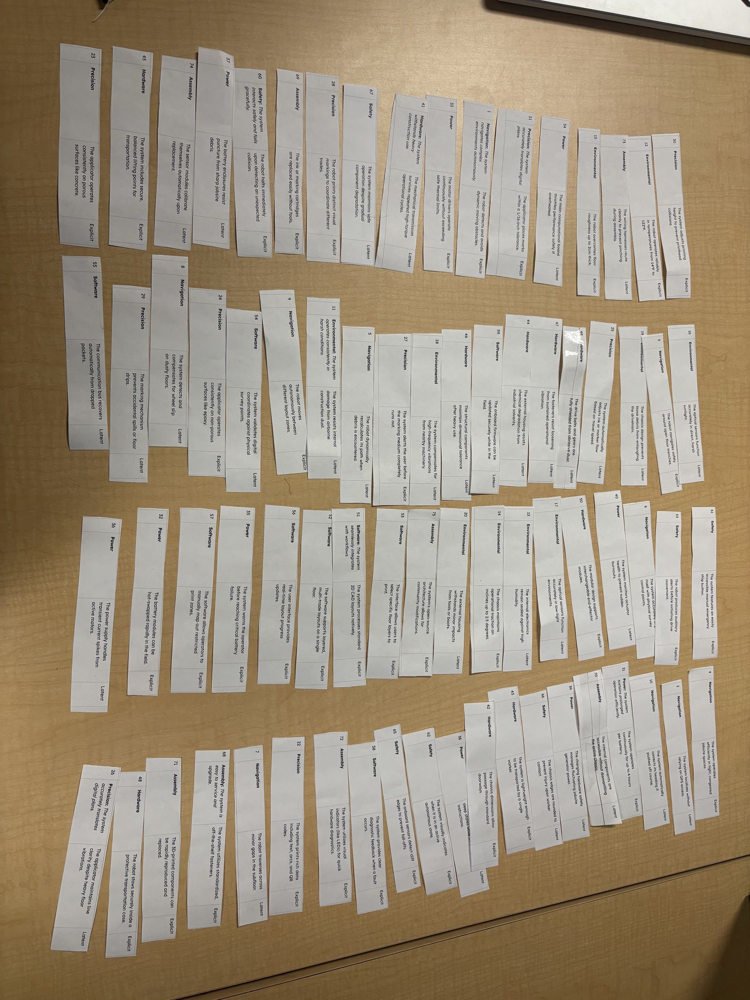
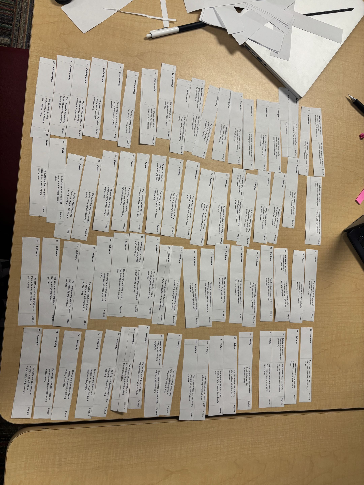

# User Needs and Benchmarking

## Stakeholders

| **Role** | **Description** | **Voice of the Customer (VOC) Sources** |
| --- | --- | --- |
| Operators | Control the robot during active use. | Technical applications and demonstrations; customer testimonials (e.g., Dusty Robotics references), online reviews, and field interviews |
| Maintainers | Keep the robotic system fully functional. | Service logs |
| Firmware Leads | Research and develop the robot's decision-making capabilities. | GitHub, because the project is open source |
| Hardware Leads | Research and develop the robot's physical capabilities. | Industry standards, technical datasheets, hardware forums (EEVblog), and expert interviews (e.g., Jake Okun's feedback) |

## Expert Interview

**Jake Okun**, Instructional Professional, School of Manufacturing Systems and Networks, Ira A. Fulton Schools of Engineering, Arizona State University. He holds degrees in Manufacturing Engineering and in Robotics and Autonomous Systems (Systems Engineering concentration), and works on wearable robotics, exoskeletons, and industrial automation.

### 1. In the robotics field, what are some issues you have encountered when troubleshooting your projects?

For example, in current exoskeleton projects, what recurring issues have you noticed during experimental trials?

### 2. Have you ever experienced communication failures between devices while working on a project? If so, what is an example?

*Context: Our project will consist of hardware design and troubleshooting communication between multiple controllers.*

### 3. When designing a robotics system with multiple components or modules, what are some of the biggest integration problems you have encountered?

**Response:** Measurements and components not fitting together properly.

### 4. What factors do you consider when selecting components such as sensors, motors, microcontrollers, or motor drivers for a robotics project?

**Response:** Power supply, dimensions, use case, customer requirements, and budget.

### 5. How important is designing a product for assembly, and what should engineers consider before they begin manufacturing a prototype?

**Response:** One of the biggest considerations is tolerance and making sure everything fits together properly. Machining capabilities also need to be considered because, without specific machinery, you may not be able to manufacture the part you originally designed.

### 6. How do you decide whether a component should be 3D printed, machined, purchased, or manufactured another way?

**Response:** It depends on the use case. If a stronger part is required, it should generally be machined or purchased. If an appropriate component is available off the shelf, it should be purchased. If something needs to be manufactured quickly or does not require as much strength, 3D printing can be a good option.

### 7. How do engineers handle situations where the ideal component is too expensive, unavailable, or difficult to source?

**Response:** You can manufacture your own component if the existing option is too expensive or substitute it with another component. If the component is not necessary, it may also be removed entirely. There is usually an alternative solution.

## Organizing Our Needs

We wrote our needs in a shared document, then printed them and cut them into individual slips so we could physically sort them. The photos below show the slips at each stage: unorganized, grouped into categories, and sorted.

| Unorganized | Categorized | Sorted |
| :---: | :---: | :---: |
| {style="transform: rotate(270deg); width: 400px;"} | {style="transform: rotate(270deg); width: 400px;"} | {style="transform: rotate(270deg); width: 400px;"} |

## Our 75 User Needs

The needs are grouped into eight categories. Each category has a **meta need** that summarizes the group. Each need is marked **Explicit** (stated directly by users) or **Latent** (an unstated need users would still expect).

### Navigation

**Meta need:** *The system navigates complex environments autonomously.*

| # | User Need Statement | Type |
| --- | --- | --- |
| 1 | The robot detects and avoids dynamic moving obstacles. | Explicit |
| 2 | The system localizes without relying on GPS access. | Latent |
| 3 | The robot navigates safely around open floor trenches. | Explicit |
| 4 | The system operates efficiently in tight, congested jobsite spaces. | Explicit |
| 5 | The robot dynamically recalculates its path when debris is encountered. | Latent |
| 6 | The system accurately aligns itself with physical survey control points. | Explicit |
| 7 | The robot traverses across minor gaps in the subfloor. | Latent |
| 8 | The system detects and compensates for wheel slip on dusty floors. | Latent |
| 9 | The robot moves autonomously between different layout zones. | Explicit |
| 10 | The system automatically corrects its heading if pushed off course. | Latent |

### Environmental

**Meta need:** *The system operates consistently in harsh conditions.*

| # | User Need Statement | Type |
| --- | --- | --- |
| 11 | The system resists internal damage from airborne construction dust. | Latent |
| 12 | The robot operates reliably in temperatures from 14 ºF to 122 ºF. | Explicit |
| 13 | The internal electronics remain sealed against high humidity. | Latent |
| 14 | The chassis maintains operational traction on inclines up to 2.5 degrees. | Explicit |
| 15 | The robot overcomes floor roughness up to 2 cm thick. | Explicit |
| 16 | The optical sensors function accurately in direct, harsh sunlight. | Latent |
| 17 | The optical sensors function accurately in low-light environments. | Latent |
| 18 | The system compensates for high-frequency vibrations from nearby machinery. | Latent |
| 19 | The chassis design prevents loose debris from entangling the drivetrain. | Latent |
| 20 | The external housing withstands minor impacts from tools or boots. | Latent |

### Precision

**Meta need:** *The system accurately translates digital plans.*

| # | User Need Statement | Type |
| --- | --- | --- |
| 21 | The applicator places marks within a 1/16-inch tolerance. | Explicit |
| 22 | The system prints rich data including text, arcs, and QR codes. | Explicit |
| 23 | The applicator operates consistently on porous surfaces like concrete. | Explicit |
| 24 | The applicator operates consistently on non-porous surfaces like epoxy. | Explicit |
| 25 | The system automatically adjusts ink or marker flow based on travel speed. | Latent |
| 26 | The applicator maintains line clarity despite heavy floor vibrations. | Latent |
| 27 | The system alerts the user before the marking medium completely runs out. | Explicit |
| 28 | The robot prints distinct visual markings to coordinate different trades. | Explicit |
| 29 | The marking mechanism prevents accidental spills or floor drips. | Latent |
| 30 | The system adjusts printing height to prevent printhead collisions. | Explicit |

### Power

**Meta need:** *The system sustains prolonged operation efficiently.*

| # | User Need Statement | Type |
| --- | --- | --- |
| 31 | The system operates continuously for up to 4 hours per battery. | Explicit |
| 32 | The battery modules can be hot-swapped rapidly in the field. | Explicit |
| 33 | The motor drivers operate continuously without exceeding safe thermal limits. | Explicit |
| 34 | The main computational board throttles performance safely if overheated. | Latent |
| 35 | The system warns the operator before reaching critical battery failure. | Explicit |
| 36 | The power supply handles transient current spikes from active motors. | Latent |
| 37 | The battery enclosures resist puncture from sharp jobsite debris. | Latent |
| 38 | The system utilizes low-power sleep states while awaiting instructions. | Latent |
| 39 | The charging hardware safely manages fluctuating jobsite generator power. | Latent |
| 40 | The system monitors actuator health to prevent sudden burnouts. | Latent |

### Hardware

**Meta need:** *The system withstands heavy construction use.*

| # | User Need Statement | Type |
| --- | --- | --- |
| 41 | The mechanical transmission survives repeated high-torque operational cycles. | Latent |
| 42 | The chassis dimensions allow passage through standard doorways. | Explicit |
| 43 | The system is lightweight enough to be transported by a single worker. | Explicit |
| 44 | The external housing resists chemical degradation from industrial solvents. | Latent |
| 45 | The system includes secure, balanced lifting points for transportation. | Explicit |
| 46 | The structural components maintain dimensional tolerance after heavy use. | Latent |
| 47 | The fasteners resist loosening from sustained operational vibration. | Latent |
| 48 | The robot stows securely inside a protective transportation case. | Explicit |
| 49 | The drive belts and gears are fully shielded from abrasive dust. | Latent |
| 50 | The modular design supports interchangeable end-effector modules. | Explicit |

### Software

**Meta need:** *The system seamlessly integrates with workflows.*

| # | User Need Statement | Type |
| --- | --- | --- |
| 51 | The system processes standard 2D CAD layouts natively. | Explicit |
| 52 | The software supports layered, multi-trade layouts on a single floor. | Explicit |
| 53 | The interface allows users to select specific floor layers to print. | Explicit |
| 54 | The system validates digital coordinates against physical survey points. | Latent |
| 55 | The communication bus recovers automatically from dropped packets. | Latent |
| 56 | The user interface provides real-time layout progress updates. | Explicit |
| 57 | The software allows operators to manually map out restricted print zones. | Explicit |
| 58 | The system provides clear diagnostic feedback when a fault occurs. | Explicit |
| 59 | The onboard firmware can be updated securely while in the field. | Latent |

### Safety

**Meta need:** *The system interacts safely and fails gracefully.*

| # | User Need Statement | Type |
| --- | --- | --- |
| 60 | The robot halts immediately upon detecting an unexpected collision. | Explicit |
| 61 | The system features an easily accessible manual emergency stop button. | Explicit |
| 62 | The system visually indicates when it is in an active autonomous state. | Explicit |
| 63 | The robot produces auditory alerts before initiating drive movement. | Explicit |
| 64 | The system fails into a safe, braked state if power is suddenly lost. | Latent |
| 65 | The onboard sensors detect cliff edges to prevent fall-offs. | Explicit |
| 66 | The chassis edges are rounded to prevent injury upon worker contact. | Latent |
| 67 | The system maintains safe operation despite gradual component degradation. | Latent |

### Assembly

**Meta need:** *The system is easy to service and upgrade.*

| # | User Need Statement | Type |
| --- | --- | --- |
| 68 | The system utilizes standardized, off-the-shelf fasteners. | Explicit |
| 69 | The ink or marking cartridges are replaced easily without tools. | Explicit |
| 70 | The internal components are accessible without dismantling the entire chassis. | Latent |
| 71 | The 3D-printed components can be rapidly reproduced and replaced. | Explicit |
| 72 | The system utilizes visual indicators (like LEDs) for quick hardware diagnostics. | Explicit |
| 73 | The wiring harnesses route cleanly to prevent pinching during assembly. | Latent |
| 74 | The sensor modules calibrate themselves automatically upon replacement. | Latent |
| 75 | The system's open-source architecture allows for community modifications. | Explicit |
