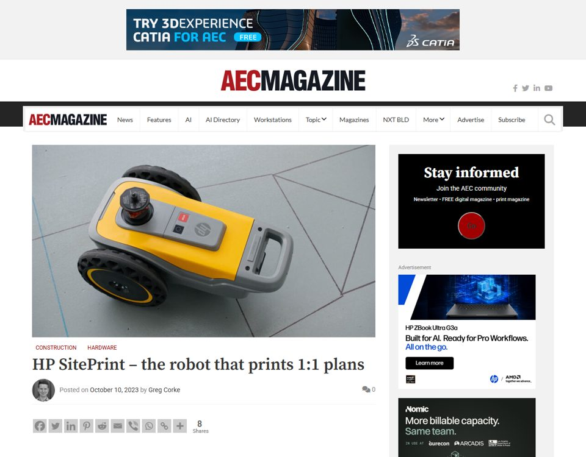
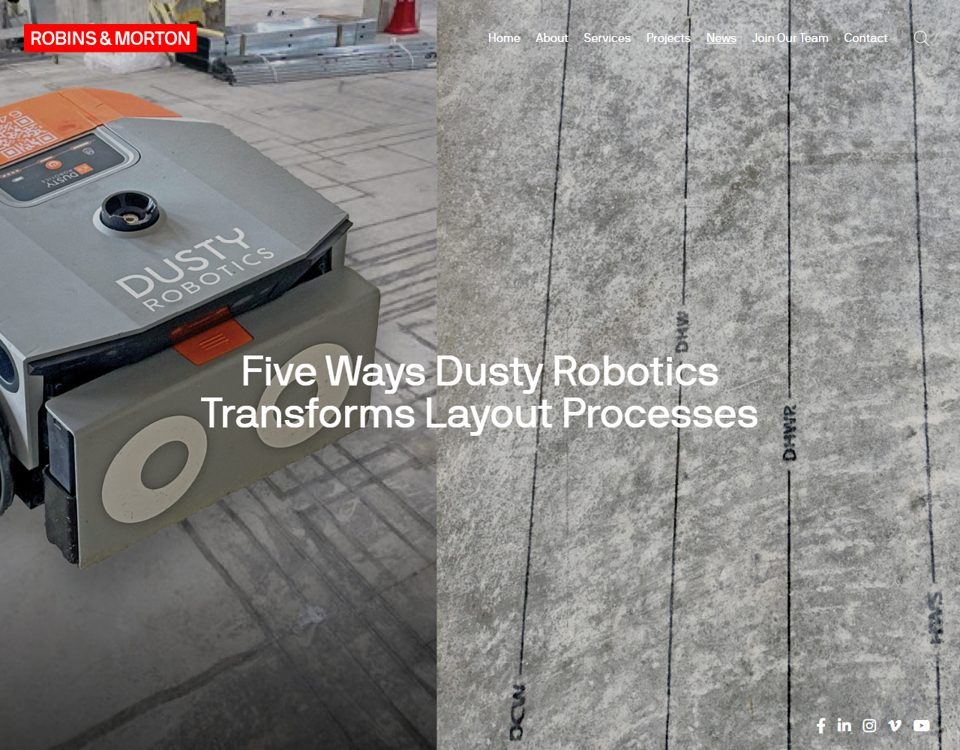
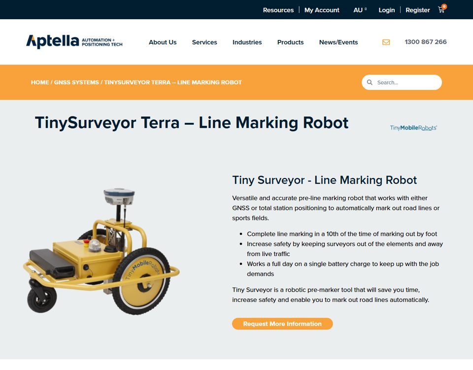
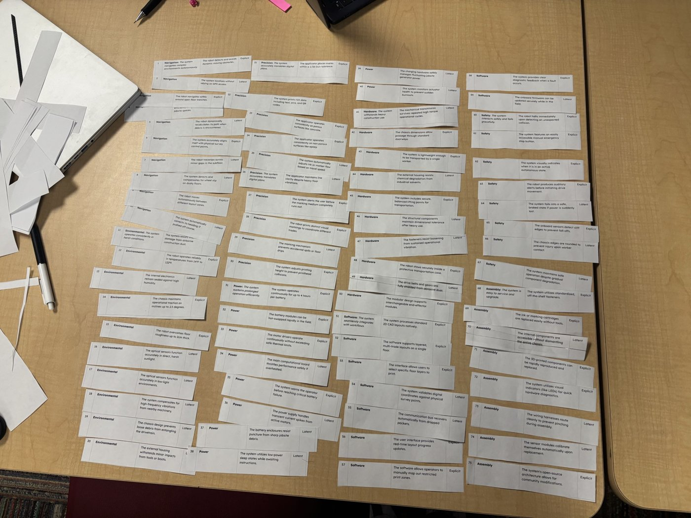

# User Needs and Benchmarking

## Stakeholders

| **Role** | **Description** | **Voice of the Customer (VOC) Sources** |
| --- | --- | --- |
| Operators | Control the robot during active use. | Technical applications and demonstrations; customer testimonials (e.g., Dusty Robotics references), online reviews, and field interviews |
| Maintainers | Keep the robotic system fully functional. | Service logs |
| Firmware Leads | Research and develop the robot's decision-making capabilities. | GitHub, because the project is open source |
| Hardware Leads | Research and develop the robot's physical capabilities. | Industry standards, technical datasheets, hardware forums (EEVblog), and expert interviews (e.g., Jake Okun's feedback) |

## Expert Interview

**Jake Okun**, Instructional Professional, School of Manufacturing Systems and Networks, Ira A. Fulton Schools of Engineering, Arizona State University. He holds degrees in Manufacturing Engineering and in Robotics and Autonomous Systems (Systems Engineering concentration), and works on wearable robotics, exoskeletons, and industrial automation.

### 1. In the robotics field, what are some issues you have encountered when troubleshooting your projects?

For example, in current exoskeleton projects, what recurring issues have you noticed during experimental trials?

### 2. Have you ever experienced communication failures between devices while working on a project? If so, what is an example?

*Context: Our project will consist of hardware design and troubleshooting communication between multiple controllers.*

### 3. When designing a robotics system with multiple components or modules, what are some of the biggest integration problems you have encountered?

**Response:** Measurements and components not fitting together properly.

### 4. What factors do you consider when selecting components such as sensors, motors, microcontrollers, or motor drivers for a robotics project?

**Response:** Power supply, dimensions, use case, customer requirements, and budget.

### 5. How important is designing a product for assembly, and what should engineers consider before they begin manufacturing a prototype?

**Response:** One of the biggest considerations is tolerance and making sure everything fits together properly. Machining capabilities also need to be considered because, without specific machinery, you may not be able to manufacture the part you originally designed.

### 6. How do you decide whether a component should be 3D printed, machined, purchased, or manufactured another way?

**Response:** It depends on the use case. If a stronger part is required, it should generally be machined or purchased. If an appropriate component is available off the shelf, it should be purchased. If something needs to be manufactured quickly or does not require as much strength, 3D printing can be a good option.

### 7. How do engineers handle situations where the ideal component is too expensive, unavailable, or difficult to source?

**Response:** You can manufacture your own component if the existing option is too expensive or substitute it with another component. If the component is not necessary, it may also be removed entirely. There is usually an alternative solution.

## Voice of the Customer Benchmarking

We benchmarked three existing layout robots to learn what users like and dislike about current products. We searched trade publications, contractor write-ups, dealer review pages, community discussion threads, and product datasheets. Independent user reviews of layout robots are rare because the products are new and mostly sold directly to large contractors, so we used a mix of sources and noted where a source may be biased.

### Search Log

| # | Search Keywords | Source Type | Results Used |
| --- | --- | --- | --- |
| 1 | HP SitePrint layout robot review contractor reddit | Trade publication | [AEC Magazine: HP SitePrint](https://aecmag.com/construction/hp-siteprint-the-robot-that-prints-11-plans/) |
| 2 | Dusty Robotics FieldPrinter review reddit construction layout problems | Dealer comparison article | [Site Precision: HP SitePrint vs. Dusty Robotics](https://siteprecisioninc.com/article/hp-siteprint-vs-dusty-robotics-which-layout-robot-is-better-for-construction/) |
| 3 | Dusty Robotics layout robot (Hacker News) | Contractor write-up | [Robins & Morton: Five Ways Dusty Robotics Transforms Layout](https://www.robinsmorton.com/five-ways-dusty-robotics-transforms-layout-processes/) (no Hacker News thread found) |
| 4 | reddit layout robot SitePrint Dusty r/Construction | Community discussion, trade publication | [Habr comment thread on HP SitePrint](https://habr.com/en/news/688834/comments), [AECbytes: Dusty Robotics in Action](https://www.aecbytes.com/feature/2024/DustyRobotics.html) (no relevant Reddit threads found) |
| 5 | Rugged Robotics OR TinyMobileRobots TinySurveyor review contractor feedback | Dealer review page, product guide | [Aptella: TinySurveyor](https://www.aptella.com/product/tiny-surveyor/), [Monsen Engineering: Terra vs. Plotter](https://monsenengineering.com/tinysurveyor-terra-vs-plotter/) (no reviews found for Rugged Robotics) |
| 6 | rpls.com forum TinySurveyor robot | Technical forum | [RPLS.com land surveyor forums](https://rpls.com/forums/) (no TinySurveyor threads found) |

### Benchmark 1: HP SitePrint

| Product Under Discussion | Vendor | Price | Description |
| --- | --- | --- | --- |
| HP SitePrint | HP | About 50,000 USD for the robot, plus 20 cents (USD) per square foot printed (includes software, service, and supplies) | A compact robot that prints layout lines, points, and text onto floors. It is guided by an external robotic total station (Trimble, Topcon, or Leica). |

{style="width: 600px;"}

*Figure:* AEC Magazine article on HP SitePrint (source of the contractor quotes below).

{style="width: 600px;"}

*Figure:* Habr community discussion of HP SitePrint (source of the community comments below).

##### Positive Feedback

| Voice of the Customer | Restated Customer Need | Type |
| --- | --- | --- |
| "We've been within, I believe, one sixteenth or one sixty-fourth of an inch on every single point." (Garret Wheat, project manager, Hoar Construction, AEC Magazine) | B1. The robot places layout marks within 1/16 inch of the design. | Explicit |
| Skanska reported a floor layout taking "45 mins instead of 7 hours." (AEC Magazine) | B2. The system completes a floor layout much faster than manual layout. | Explicit |
| L5 Drywall reported laying out rooms with "one guy instead of three." (AEC Magazine) | B3. A single operator can run the layout process. | Explicit |
| "SitePrint is able to run over obstacles up to 3/4in thick and continue to print accurately." (Site Precision, an HP dealer) | B4. The robot keeps printing accurately after crossing small floor obstacles. | Latent |

##### Negative Feedback

| Voice of the Customer | Restated Customer Need | Type |
| --- | --- | --- |
| Summary: The robot needs a robotic total station from a supported brand, plus two to three control points, and stops if it loses line of sight for more than five seconds. (AEC Magazine) | B5. The robot keeps track of its position without depending on expensive external survey equipment. | Latent |
| Summary: The robot costs about 50,000 USD, plus a per-square-foot printing fee. (AEC Magazine) | B6. The system is affordable for small contractors. | Explicit |
| A commenter mocked the product's "original© cartridges," suggesting buyers will be locked into HP's supplies. (NekitGeek, Habr, translated) | B7. The marking system uses standard, low-cost supplies that are not locked to one vendor. | Latent |
| "The small size of the front wheel on HP's product bothers me somewhat." (AndreyDmitriev, Habr, translated) | B8. The drivetrain handles rough, uneven job-site floors without getting stuck. | Latent |
| Summary: The robot stops when it reaches a ledge over 2.5 inches or an obstacle, and the obstacle must be cleared and the area reprinted. (AEC Magazine) | B9. The robot continues marking around obstacles without operator help. | Latent |

### Benchmark 2: Dusty Robotics FieldPrinter

| Product Under Discussion | Vendor | Price | Description |
| --- | --- | --- | --- |
| FieldPrinter (FieldPrint Platform) | Dusty Robotics | Varies: subscription only, priced by layout scope; the hardware is never owned | A layout robot that prints lines, text, and symbols from CAD or BIM models onto concrete slabs. It is guided by its own laser tracker and is sold in North America only. |

{style="width: 600px;"}

*Figure:* Robins & Morton's write-up of using Dusty Robotics on their projects (source of the contractor quotes below).

##### Positive Feedback

| Voice of the Customer | Restated Customer Need | Type |
| --- | --- | --- |
| "They were all able to competently operate it with just one day of training." (Robins & Morton) | B10. New operators can learn the system in one day. | Explicit |
| "In just five days, we printed every trade contractor's work for 20,000 square feet." (Robins & Morton) | B11. The system lays out every trade's work on a floor much faster than manual methods. | Explicit |
| "We're taking away the risk that someone reads the wrong number off the drawings." (Robins & Morton) | B12. The system prints directly from the digital plan, so no one has to read measurements by hand. | Explicit |
| "It prints very accurately according to the model. It can print anything, and it can print fast." (Robins & Morton) | B13. The robot prints lines, text, and symbols that match the model. | Explicit |

##### Negative Feedback

| Voice of the Customer | Restated Customer Need | Type |
| --- | --- | --- |
| In extreme cold (18 °F) and high wind, "we ended up having to bring it inside and let it warm up." (Robins & Morton) | B14. The robot operates reliably in cold and windy outdoor conditions. | Explicit |
| "If we would have had more up-front time, we could have leveraged it more effectively." (Robins & Morton) | B15. The system can be put to use without lengthy up-front planning. | Latent |
| "Dusty is subscription only," and contractors "never own the hardware." (Site Precision, an HP dealer, so possibly biased) | B16. Contractors can own the robot outright. | Explicit |
| The laser tracker is "built for controlled environments, not construction sites" and "carries a low IP54 rating." (Site Precision) | B17. The positioning hardware withstands job-site dust and moisture. | Latent |
| The main support center is in California, which "can prove to be difficult due to time zone differences." (Site Precision) | B18. Users can get help or fix problems without relying on one distant vendor. | Latent |

### Benchmark 3: TinyMobileRobots TinySurveyor

| Product Under Discussion | Vendor | Price | Description |
| --- | --- | --- | --- |
| TinySurveyor (Terra and Plotter models) | TinyMobileRobots (sold through dealers such as Aptella and Monsen Engineering) | Varies: quoted by dealers | An outdoor line-marking and stake-out robot that sprays marks using GNSS or a total station for positioning. It runs about 8 hours per charge and uses standard aerosol paint cans. |

{style="width: 600px;"}

*Figure:* Aptella's TinySurveyor page, which includes the customer reviews below.

##### Positive Feedback

| Voice of the Customer | Restated Customer Need | Type |
| --- | --- | --- |
| "Since using the Tiny Surveyor, accuracy is improved and the efficiency has definitely been improved." (Paul Farmilo, Shire of Esperance) | B19. The robot marks more accurately and efficiently than manual layout. | Explicit |
| "You're not having to send a surveyor out to site for 2-3 hours." (Dayne Corps, Karratha Earthmoving) | B20. A regular crew member can complete marking without a dedicated surveyor. | Explicit |
| "So far we haven't had an instance where we set out a line onsite that's been incorrect." (James Sharpe, CPB Contractors) | B21. Every line the robot marks matches the design. | Explicit |
| "With the Tiny Surveyor it took 2.5 hours. There's a definite 4-to-1 ratio there." (Jon Rasmussen) | B22. The robot cuts marking time to a fraction of manual time. | Explicit |

##### Negative Feedback

| Voice of the Customer | Restated Customer Need | Type |
| --- | --- | --- |
| Summary: Accuracy is listed as "2-3cm," far coarser than the 1/16-inch tolerance needed for building layout. (Aptella datasheet) | B23. The system marks within building-layout tolerance, not just roadwork tolerance. | Explicit |
| Summary: Rough ground needs the Terra model, while the Plotter is "optimized for flat surfaces," so one model does not cover both. (Monsen Engineering guide) | B24. A single robot handles both rough ground and finished slabs. | Latent |
| Summary: The robot takes standard aerosol cans, but "the nozzle must be replaced with the standardised nozzle supplied with the robot." (Aptella datasheet) | B25. Marking supplies can be replaced with standard parts. | Latent |
| Summary: Centimeter accuracy requires a GNSS receiver, and millimeter precision requires a robotic total station. (Monsen Engineering guide) | B26. The robot positions itself accurately without extra survey instruments. | Latent |

### Benchmarking Takeaways

- **Accuracy is the top need.** Users of every product judged it first on whether the marks matched the design (B1, B13, B21). This supports our 1/16-inch tolerance need (#21).
- **Cost and ownership are the biggest complaints.** HP SitePrint costs about 50,000 USD plus printing fees, and Dusty can only be rented by subscription (B6, B16). This supports our goal of an open-source, affordable robot.
- **Job-site conditions cause problems.** Cold, wind, dust, ledges, and rough ground all limited current products (B8, B14, B17, B24). This supports our environmental needs and our choice of treads for traction.
- **Users want independence from expensive add-ons.** Both HP and TinySurveyor need external survey equipment, and HP's supplies may be locked to one vendor (B5, B7, B25, B26).

## Organizing Our Needs

We wrote our needs in a shared document, then printed them and cut them into individual slips so we could physically sort them. The photos below show the slips at each stage: unorganized, grouped into categories, and sorted.

| Unorganized | Categorized | Sorted |
| :---: | :---: | :---: |
|  |  |  |

## Our 75 User Needs

The needs are grouped into eight categories. Each category has a **meta need** that summarizes the group. Each need is marked **Explicit** (stated directly by users) or **Latent** (an unstated need users would still expect).

### Navigation

**Meta need:** *The system navigates complex environments autonomously.*

| # | User Need Statement | Type |
| --- | --- | --- |
| 1 | The robot detects and avoids dynamic moving obstacles. | Explicit |
| 2 | The system localizes without relying on GPS access. | Latent |
| 3 | The robot navigates safely around open floor trenches. | Explicit |
| 4 | The system operates efficiently in tight, congested jobsite spaces. | Explicit |
| 5 | The robot dynamically recalculates its path when debris is encountered. | Latent |
| 6 | The system accurately aligns itself with physical survey control points. | Explicit |
| 7 | The robot traverses across minor gaps in the subfloor. | Latent |
| 8 | The system detects and compensates for wheel slip on dusty floors. | Latent |
| 9 | The robot moves autonomously between different layout zones. | Explicit |
| 10 | The system automatically corrects its heading if pushed off course. | Latent |

### Environmental

**Meta need:** *The system operates consistently in harsh conditions.*

| # | User Need Statement | Type |
| --- | --- | --- |
| 11 | The system resists internal damage from airborne construction dust. | Latent |
| 12 | The robot operates reliably in temperatures from 14 ºF to 122 ºF. | Explicit |
| 13 | The internal electronics remain sealed against high humidity. | Latent |
| 14 | The chassis maintains operational traction on inclines up to 2.5 degrees. | Explicit |
| 15 | The robot overcomes floor roughness up to 2 cm thick. | Explicit |
| 16 | The optical sensors function accurately in direct, harsh sunlight. | Latent |
| 17 | The optical sensors function accurately in low-light environments. | Latent |
| 18 | The system compensates for high-frequency vibrations from nearby machinery. | Latent |
| 19 | The chassis design prevents loose debris from entangling the drivetrain. | Latent |
| 20 | The external housing withstands minor impacts from tools or boots. | Latent |

### Precision

**Meta need:** *The system accurately translates digital plans.*

| # | User Need Statement | Type |
| --- | --- | --- |
| 21 | The applicator places marks within a 1/16-inch tolerance. | Explicit |
| 22 | The system prints rich data including text, arcs, and QR codes. | Explicit |
| 23 | The applicator operates consistently on porous surfaces like concrete. | Explicit |
| 24 | The applicator operates consistently on non-porous surfaces like epoxy. | Explicit |
| 25 | The system automatically adjusts ink or marker flow based on travel speed. | Latent |
| 26 | The applicator maintains line clarity despite heavy floor vibrations. | Latent |
| 27 | The system alerts the user before the marking medium completely runs out. | Explicit |
| 28 | The robot prints distinct visual markings to coordinate different trades. | Explicit |
| 29 | The marking mechanism prevents accidental spills or floor drips. | Latent |
| 30 | The system adjusts printing height to prevent printhead collisions. | Explicit |

### Power

**Meta need:** *The system sustains prolonged operation efficiently.*

| # | User Need Statement | Type |
| --- | --- | --- |
| 31 | The system operates continuously for up to 4 hours per battery. | Explicit |
| 32 | The battery modules can be hot-swapped rapidly in the field. | Explicit |
| 33 | The motor drivers operate continuously without exceeding safe thermal limits. | Explicit |
| 34 | The main computational board throttles performance safely if overheated. | Latent |
| 35 | The system warns the operator before reaching critical battery failure. | Explicit |
| 36 | The power supply handles transient current spikes from active motors. | Latent |
| 37 | The battery enclosures resist puncture from sharp jobsite debris. | Latent |
| 38 | The system utilizes low-power sleep states while awaiting instructions. | Latent |
| 39 | The charging hardware safely manages fluctuating jobsite generator power. | Latent |
| 40 | The system monitors actuator health to prevent sudden burnouts. | Latent |

### Hardware

**Meta need:** *The system withstands heavy construction use.*

| # | User Need Statement | Type |
| --- | --- | --- |
| 41 | The mechanical transmission survives repeated high-torque operational cycles. | Latent |
| 42 | The chassis dimensions allow passage through standard doorways. | Explicit |
| 43 | The system is lightweight enough to be transported by a single worker. | Explicit |
| 44 | The external housing resists chemical degradation from industrial solvents. | Latent |
| 45 | The system includes secure, balanced lifting points for transportation. | Explicit |
| 46 | The structural components maintain dimensional tolerance after heavy use. | Latent |
| 47 | The fasteners resist loosening from sustained operational vibration. | Latent |
| 48 | The robot stows securely inside a protective transportation case. | Explicit |
| 49 | The drive belts and gears are fully shielded from abrasive dust. | Latent |
| 50 | The modular design supports interchangeable end-effector modules. | Explicit |

### Software

**Meta need:** *The system seamlessly integrates with workflows.*

| # | User Need Statement | Type |
| --- | --- | --- |
| 51 | The system processes standard 2D CAD layouts natively. | Explicit |
| 52 | The software supports layered, multi-trade layouts on a single floor. | Explicit |
| 53 | The interface allows users to select specific floor layers to print. | Explicit |
| 54 | The system validates digital coordinates against physical survey points. | Latent |
| 55 | The communication bus recovers automatically from dropped packets. | Latent |
| 56 | The user interface provides real-time layout progress updates. | Explicit |
| 57 | The software allows operators to manually map out restricted print zones. | Explicit |
| 58 | The system provides clear diagnostic feedback when a fault occurs. | Explicit |
| 59 | The onboard firmware can be updated securely while in the field. | Latent |

### Safety

**Meta need:** *The system interacts safely and fails gracefully.*

| # | User Need Statement | Type |
| --- | --- | --- |
| 60 | The robot halts immediately upon detecting an unexpected collision. | Explicit |
| 61 | The system features an easily accessible manual emergency stop button. | Explicit |
| 62 | The system visually indicates when it is in an active autonomous state. | Explicit |
| 63 | The robot produces auditory alerts before initiating drive movement. | Explicit |
| 64 | The system fails into a safe, braked state if power is suddenly lost. | Latent |
| 65 | The onboard sensors detect cliff edges to prevent fall-offs. | Explicit |
| 66 | The chassis edges are rounded to prevent injury upon worker contact. | Latent |
| 67 | The system maintains safe operation despite gradual component degradation. | Latent |

### Assembly

**Meta need:** *The system is easy to service and upgrade.*

| # | User Need Statement | Type |
| --- | --- | --- |
| 68 | The system utilizes standardized, off-the-shelf fasteners. | Explicit |
| 69 | The ink or marking cartridges are replaced easily without tools. | Explicit |
| 70 | The internal components are accessible without dismantling the entire chassis. | Latent |
| 71 | The 3D-printed components can be rapidly reproduced and replaced. | Explicit |
| 72 | The system utilizes visual indicators (like LEDs) for quick hardware diagnostics. | Explicit |
| 73 | The wiring harnesses route cleanly to prevent pinching during assembly. | Latent |
| 74 | The sensor modules calibrate themselves automatically upon replacement. | Latent |
| 75 | The system's open-source architecture allows for community modifications. | Explicit |
