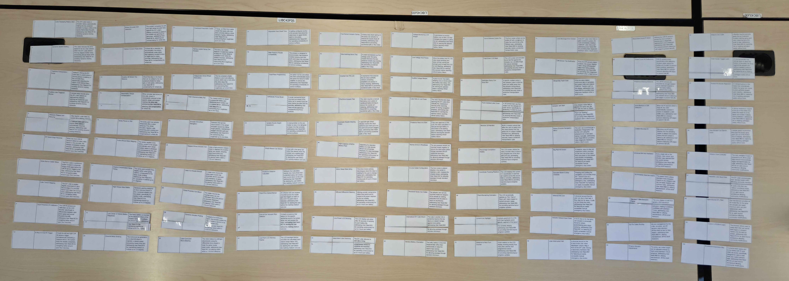
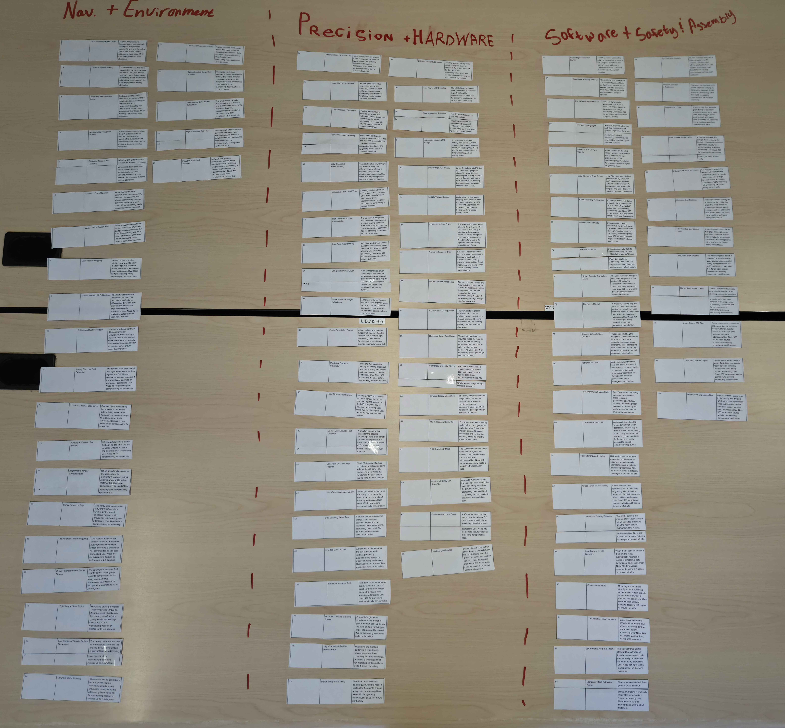
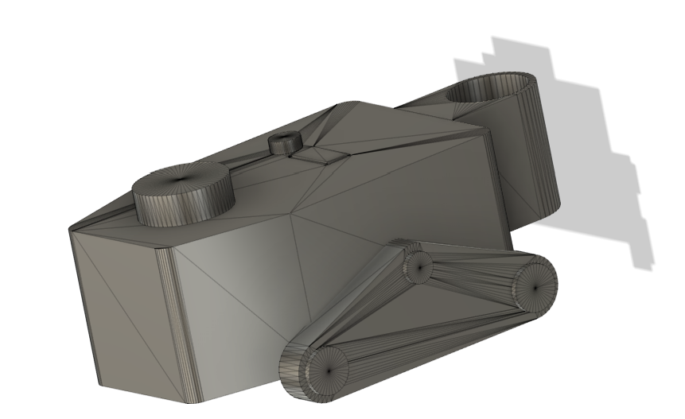
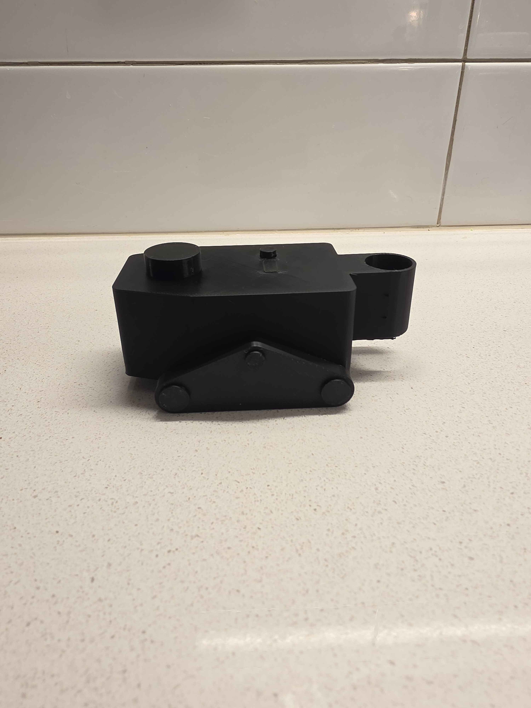

# Design Ideation

## Section Overview

> The goal of this section was to create, organize, and develop a large set of possible features for our team’s robotics project, then combine the strongest ideas into three distinct product concepts that visually demonstrate how our design could meet the project’s user needs and technical requirements.

## Our Ideas

| Unsorted |
| :---: |
|  |

| Categorized |
| :---: |
|  |

## How We Chose Our Concept

We arrived at our final concept by **combining ideas** rather than picking a single one.

1. **Starting point: a motor driver.** Our first direction was a DC motor driver with integrated brake chopper and regenerative-braking protection. As we planned the work, we realized a motor driver alone would not give five team members enough meaningful work to divide. Each of us needed a distinct subsystem to design.
2. **Building on the idea.** Instead of dropping the motor driver, we made it one part of a larger system. We asked what product needs a reliable motor driver *and* enough other subsystems for the whole team. That led us to **OpenField**, an autonomous construction layout robot. The motor driver became the drive subsystem, alongside a master controller, LiDAR obstacle detection, cliff sensing, and a spray marking system.
3. **Learning from existing products.** We studied commercial layout robots, including HP SitePrint and Dusty Robotics' FieldPrinter. Both show the value of automated layout, but they are expensive, closed systems. This shaped our goal of an open-source, affordable alternative.
4. **Choosing the drivetrain.** We chose **treads instead of wheels** because they give more traction on rough and loose surfaces such as grass, dirt, and uneven job-site ground, where wheels are more likely to slip. Slipping would throw off where the robot marks.

**How the final design differs from our early ideation:** Our early brainstorming centered on the motor driver as the whole product. The final design keeps that work as the drive subsystem, and expands the product around it into a complete layout robot with five subsystems, one per team member.

## Product Concepts

| CAD Model |
| :---: |
| {style="width: 800px; height: auto;"} |
> Modeled in Fusion 360 by Tan Thanh Huynh.

| 3D Print |
| :---: |
|  |
> Printed in PLA by Landon Kuhman.

## Our Video

<video controls width="100%" preload="metadata">
  <source src="../image/OpenField_Ad.mp4" type="video/mp4">
  Your browser does not support embedded video. <a href="../image/OpenField_Ad.mp4">Download the video</a>.
</video>

> DISCLOSURE: Our video has been created using the assistance of AI.
