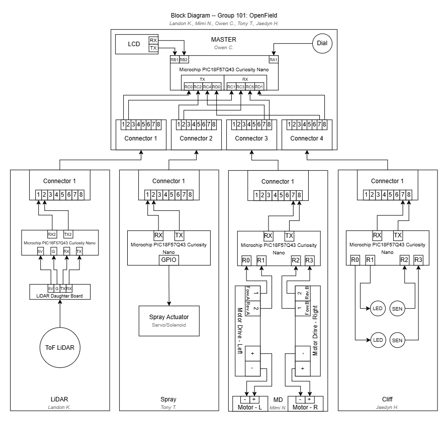

# Team Block Diagram

**Figure 1:** Team block diagram for Project OpenField, showing the Master board and the four subsystem boards. Click the image to enlarge.

## How the System Is Connected

OpenField uses a **hub-and-spoke** layout. One **Master** board sits in the middle and connects to four subsystem boards, one designed by each team member:

| Subsystem | Owner | Key Components | Connection to Master |
| --- | --- | --- | --- |
| Master | Owen C. | PIC18F57Q43 Curiosity Nano, LCD (UART), dial input | Hub: four 8-pin ribbon connectors |
| LiDAR | Landon K. | PIC18F57Q43 Curiosity Nano, ToF LiDAR on a daughter board (UART) | UART over Connector 1 |
| Spray | Thanh H. | PIC18F57Q43 Curiosity Nano, servo/solenoid spray actuator (GPIO) | UART over Connector 2 |
| Motor Driver | Mimi N. | PIC18F57Q43 Curiosity Nano, left and right motor drivers, two DC motors | UART over Connector 3 |
| Cliff | Jaedyn H. | PIC18F57Q43 Curiosity Nano, two LED and sensor pairs for cliff detection | UART over Connector 4 |

Every board talks to the Master over its own **UART** link (TX/RX) through an **8-contact ribbon cable**. Subsystem boards never talk to each other directly. All communication goes through the Master.

## Why We Structured It This Way

- **One board per team member.** Each person owns a complete subsystem, from its sensor or actuator to its microcontroller. That gives everyone an equal share of hardware and firmware work, and each board can be built and tested on its own before integration.
- **A single Master makes the decisions.** Only the Master combines sensor data and decides when to drive or spray. This keeps the control logic in one place and makes the system easier to debug. It also matches our [software proposal](07-Software%20Proposal.md), where every board runs the same Read → Think → Output loop.
- **The same microcontroller everywhere.** Using the PIC18F57Q43 Curiosity Nano on every board means one toolchain and shared code, and boards can be swapped if one fails.
- **Separate UART links on standard connectors.** Giving each subsystem its own UART channel avoids bus conflicts between boards. Using the same 8-pin ribbon connector for every board keeps the wiring consistent and lets subsystems be unplugged and replaced easily.

## How the Block Diagram Meets Our Product Needs

| Product need (from [User Needs](04-%20User%20Needs%20and%20Benchmarking.md)) | Where it is handled in the block diagram |
| --- | --- |
| Detect and avoid obstacles (needs #1, #60) | The ToF LiDAR subsystem reports obstacle data to the Master. |
| Detect cliff edges to prevent fall-offs (need #65) | The Cliff subsystem's two LED and sensor pairs check for drop-offs. |
| Accurate, controlled movement (needs #10, #21) | The Motor Driver controls the left and right motors independently for steering. |
| Mark the layout on the floor (needs #21, #23) | The Spray subsystem drives the servo/solenoid applicator. |
| Clear status and diagnostic feedback (needs #56, #58) | The Master's LCD shows status, and the dial gives the operator a simple input. |
| Easy to service and upgrade (needs #50, #70) | Modular boards on standard ribbon connectors can be unplugged and replaced. |
