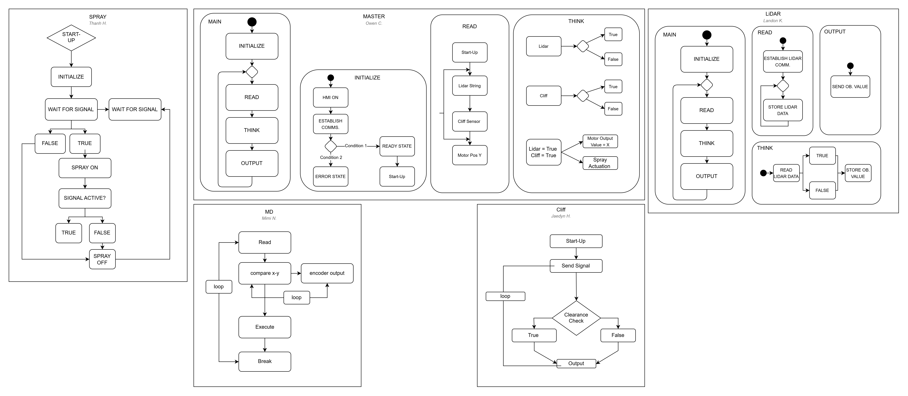

# Software Proposal

## Overview

This page describes the planned logical behavior of the software running on each microcontroller in our system. Each subsystem has its own activity diagram, created by the team member responsible for it. The Master board coordinates the subsystems: it reads data from the LiDAR and cliff sensors, decides what to do, and then commands the motor driver and the spray system.

| Subsystem | Owner | Role |
| --- | --- | --- |
| Master | Owen C. | Starts the system, collects sensor data, and decides on motor and spray actions |
| LiDAR | Landon K. | Reads the LiDAR sensor and reports obstacle values to the Master |
| Cliff | Jaedyn H. | Checks for drop-offs and reports clearance to the Master |
| Motor Driver (MD) | Mimi N. | Compares current and target position and drives the motor |
| Spray | Thanh H. | Turns the sprayer on and off when signaled |

## Software Diagram

**Figure 1:** UML activity diagrams for the Master, LiDAR, Cliff, Motor Driver, and Spray microcontrollers. Click the image to enlarge.

Diagram source file: [SoftwareProposal.drawio](image/SoftwareProposal.drawio) (open it with [draw.io](https://app.diagrams.net) using *File → Open from → Device*).

## Subsystem Descriptions

### Master

- **Main:** After it starts, the Master initializes and then runs a continuous **Read → Think → Output** loop.
- **Initialize:** Turns on the HMI and establishes communication with the other boards. If initialization succeeds, it enters a ready state and starts up. If it fails, it enters an error state.
- **Read:** Collects the LiDAR string, the cliff sensor value, and the current motor position (Y).
- **Think:** Turns the LiDAR and cliff readings into true/false conditions. When both conditions are met, it sets the motor output value and actuates the spray.

### LiDAR

- **Main:** Initializes and then loops through **Read → Think → Output**.
- **Read:** Establishes communication with the LiDAR and repeatedly stores incoming LiDAR data.
- **Think:** Evaluates the LiDAR data as true or false and stores the resulting obstacle value.
- **Output:** Sends the obstacle value to the Master.

### Cliff

After start-up, the cliff board sends a signal and runs a clearance check. The result (true or false) is sent as the output, and the board loops back to send the next signal.

### Motor Driver (MD)

The motor driver reads the commanded position, compares the current position (x) with the target (y), and uses encoder output to keep updating that comparison. When the positions differ, it executes the move. It breaks out of the move once the target is reached, then loops back to read the next command.

### Spray

After start-up and initialization, the spray board waits for a signal from the Master. When the signal is true, it turns the sprayer on and keeps checking whether the signal is still active. When the signal goes false, it turns the sprayer off and returns to waiting for the next signal.
